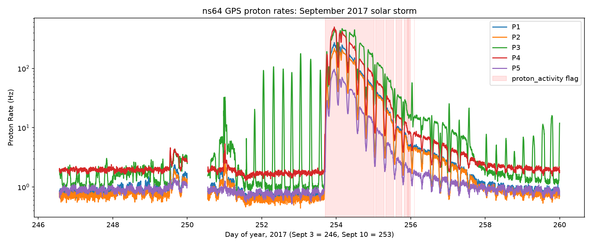

# Uatu

Uatu downloads public energetic particle data from detectors flown on GPS satellites,
checks each file for problems, and reports on the radiation environment those satellites
fly through, including flagging solar storms. The detectors were built by Los Alamos National
Laboratory and fly on GPS satellites as part of the NUDET Detection System (NDS).

Named after Marvel's Watcher, who observes from the Moon and never interferes.

This is a learning project for practicing data pipelines, Python, Bash, and Git.

## Status

Mission 1: The Watch (complete)

- [x] Set up the environment and repo
- [x] Download one satellite's data for September 2017 (weeks starting Sept 3 and Sept 10)
- [x] Read a data file and parse its JSON header
- [x] Drop bad records and replace fill values
- [x] Plot proton rates across both weeks
- [x] Flag periods of significant proton activity

Future missions:

- [ ] Mission 2: Tremors (earthquake vs. explosion)
- [ ] Mission 3: False Light (lightning vs. the "double flash")

## How it works

| Step | Script | What it does |
|---|---|---|
| 1. Download | `fetch_data.sh` | Downloads weekly data files for one GPS satellite (ns64) from NOAA NCEI. Skips files it already has and downloads to a temporary file first, so a broken download never looks complete. |
| 2. Read | `gpsfile.py` | Parses each file's JSON header into a column map, loads the data with numpy, replaces fill values with NaN, and drops records flagged by `dropped_data`. Run on its own, it prints a summary of one week. |
| 3. Plot | `plot_rates.py` | Plots all five proton channels (P1–P5) across both weeks on a log scale, shows dropped records as gaps, and shades periods flagged by `proton_activity`. |

Downloaded data goes to `data/raw/`, which is not committed to the repo.

## Usage

```bash
# Set up the environment
micromamba create -n uatu -c conda-forge python numpy matplotlib ruff
micromamba activate uatu

# Download the data
./scripts/fetch_data.sh

# Summarize one week
python scripts/gpsfile.py data/raw/ns64_170910_v1.10.ascii

# Plot both weeks
python scripts/plot_rates.py
```

## Findings



### The September 10 solar proton event

- All five proton channels jumped within hours at about day 253.7 (Sept 10), peaked on day 254,
and decayed back to the quiet baseline by about day 258.
- Maximum rates rose 50–90× compared with the week before (P1: 4.5 → 274 Hz, P4: 5.4 → 502 Hz).
- `proton_activity` flagged 753 records (about 50 hours). The flag covers the strongest part of the
event but switches on and off as the rates dip every orbit, and it misses the slow tail after day 256.

### The September 6 flare

- A small rise in P1–P5 around day 249.5 lines up with the X9.3 flare on Sept 6. It never reached
the `proton_activity` threshold, so the flag shows nothing for that week.

### P3 picks up electrons

- From about day 251, P3 spikes roughly every 12 hours while the other channels stay flat. GPS
satellites orbit about every 12 hours, and LANL's README warns that P3 can respond to
relativistic electrons during strong radiation belt enhancements. These spikes are most likely
electrons, not protons.

### Data quality

- Week of Sept 3: 401 of 2,520 records (16%) were flagged as dropped, in two chunks: the first
~14 hours of the week and day 250.0–250.6.
- Week of Sept 10: no dropped records.

## Data

GPS Energetic Particle Data (CXD and BDD-IIR), released by Los Alamos National Laboratory
and hosted by NOAA's National Centers for Environmental Information
(https://www.ncei.noaa.gov/products/GPS-energetic-particles).
